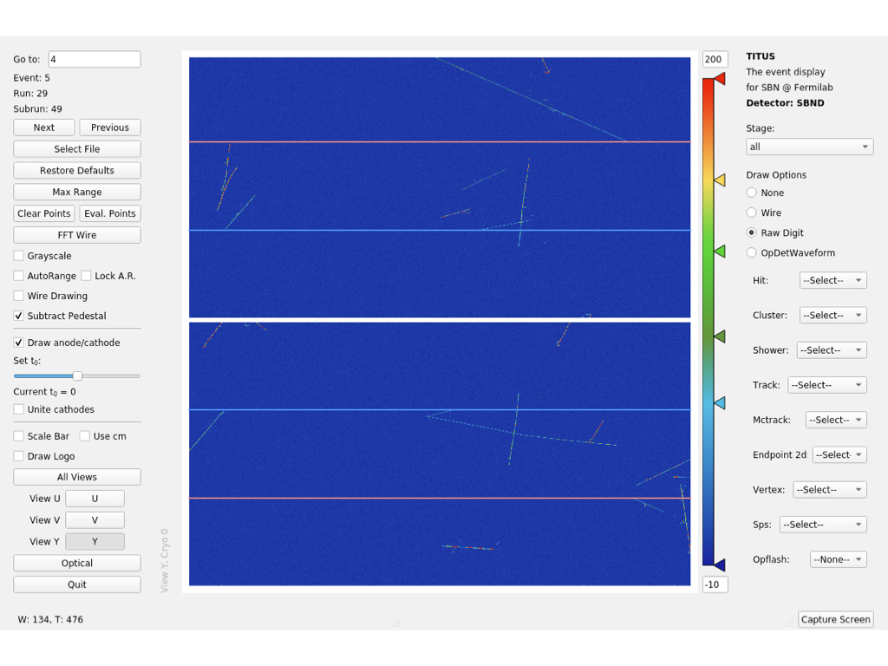
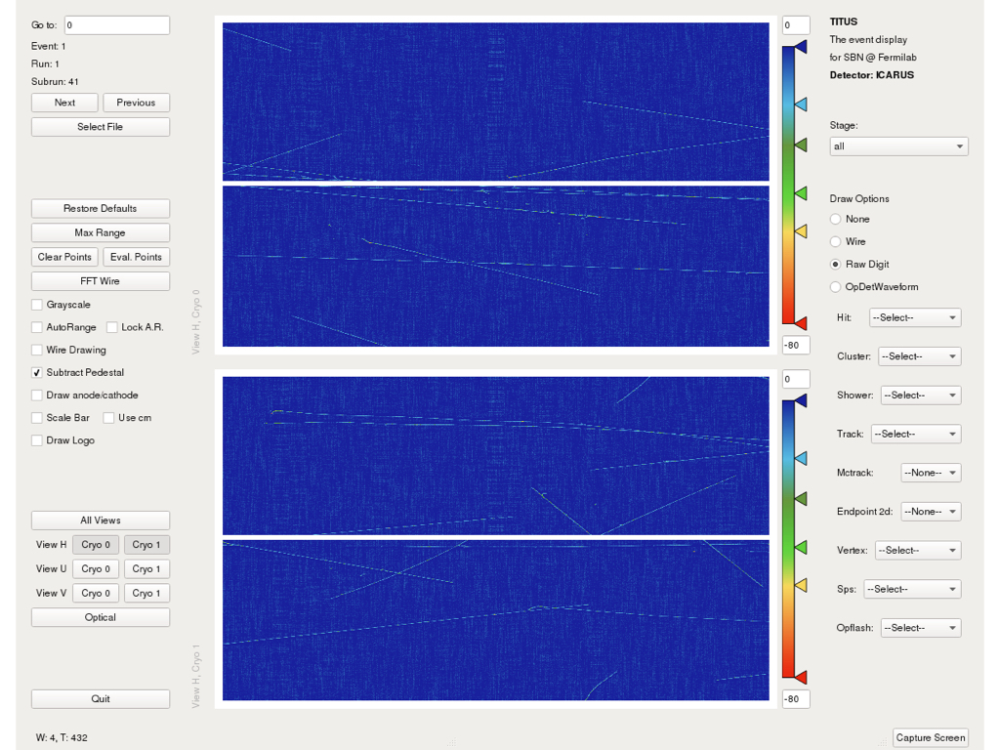
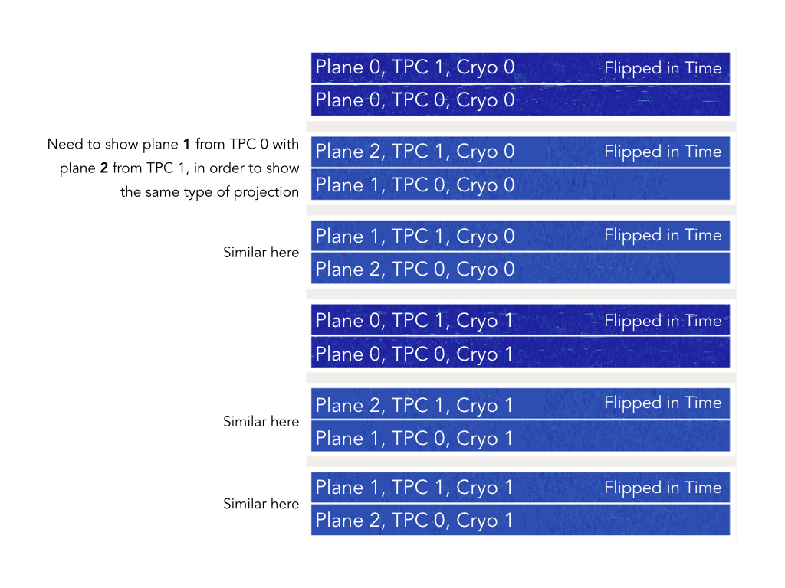

# Gallery Framework

## What is this?

This is a light framework that interfaces with gallery to read art-root files.  You have probably used larlite, which gives a light framework for reading and writing larlite format root files.  Gallery is a system to read art-root files, but doesn't provide any of the other useful tools you're used to.  You have to write your own event loop, build your code yourself, make sure to get all the linked libraries correct, etc.

This framework tries to help with that.  It interfaces with gallery to provide a larlite-style interface.  You write classes that extend from ana_base.h, just like in larlite.  Instead of receiving storage_manager, you receive gallery::Event.  You still have access to a lot of tools from larlite like GeometryHelper and LArUtils in general.

## TITUS Event Display

This framework contains TITUS: the event display for SBND at Fermilab. TITUS allows to visualize both raw and reconstructed data in 2D and 3D from the all the detectors in SBN program: SBND, MicroBooNE and ICARUS.

### TITUS for SBND

### TITUS for ICARUS

## Requirements

TITUS builds against the LArSoft packages from spack on cvmfs (AlmaLinux 9
gpvms): gallery and the data products (lardataobj, larcoreobj, nusimdata,
sbnobj). sbndcode and icaruscode are not needed. `env.sh` loads a pinned,
consistent set of packages, the compiler they were built with, and a python
venv with the GUI packages (PyQt5, pyqtgraph, numpy) that spack doesn't have.

## How to build and run the event display

With spack set up:

    source env.sh                  # the first time, also creates the python venv
    cmake -S . -B build
    cmake --build build -j 4
    evd.py /path/to/art-root-file.root

`env.sh` puts `build/lib` on `LD_LIBRARY_PATH`, where ROOT finds the product
reader, and `UserDev/EventDisplay/python` (`evd.py`) on `PATH`. To use an
install instead of the build tree, `cmake --install build --prefix <dir>` and
`TITUS_BUILD_DIR=<dir> source env.sh`; the install holds the libraries only,
the python package always comes from the source tree. By default only the reader library is built; `-DTITUS_LEGACY=ON` also
builds the old gallery-framework libraries (`core/`) and the 3D viewer, which
need larcorealg and lardataalg loaded as well. To change the LArSoft release,
see the comments at the top of `env.sh`.
